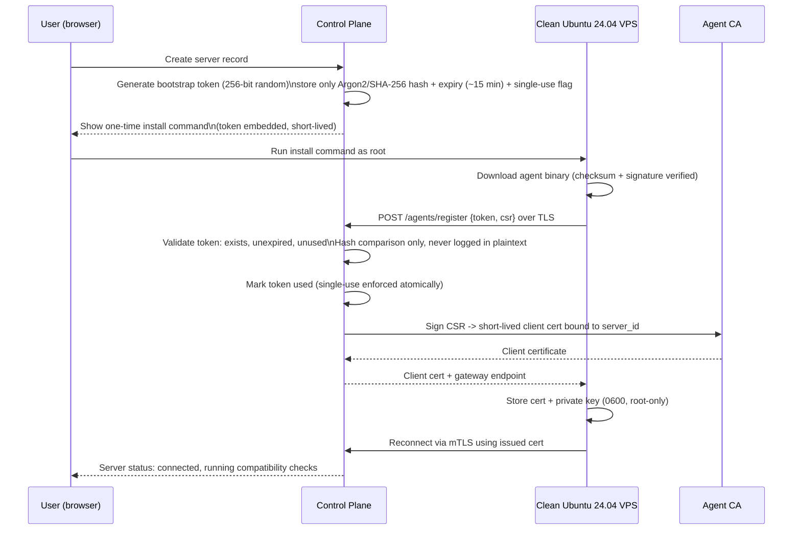

# Server Agent Security & Trust Model

> **Status note:** written as the pre-implementation trust-model design. §1–§4 are
> implemented and were exercised in real integration testing (see `TESTING.md`); §5–§6
> describe Phase 2 mechanisms (commit-confirm SSH/firewall changes, self-repair) that do
> not exist in code yet. Each section below is annotated with its current status.

## 1. Registration flow (bootstrap token → machine identity) — **implemented**



Properties this guarantees:

- **Single-use**: the token is consumed atomically on first valid exchange; a replay
  with the same token after success (or after expiry) is rejected.
- **Expires quickly**: default 15 minutes from creation; unused tokens are periodically
  purged.
- **Stored securely**: only a salted hash of the token is persisted; the plaintext token
  exists only in the one-time install command shown to the user and in the ephemeral
  process environment on the VPS during registration.
- **Never in permanent logs**: request logging middleware redacts the token field before
  writing structured logs (deny-list is insufficient — use an explicit allow-list of
  loggable fields on the registration endpoint).
- **Exchangeable for identity**: successful registration yields a durable, per-server
  client certificate — the token itself grants no ongoing access.
- **Revocable**: an unused token can be revoked from the dashboard (e.g., user made a
  mistake, wants to reissue); an already-exchanged identity is revoked separately (§3).

## 2. Ongoing authentication: mutual TLS — **partially implemented**

- All agent ↔ control-plane traffic (registration excluded, which is TLS + token) uses
  **mTLS**: the gateway only accepts connections presenting a valid, non-revoked
  certificate issued by the internal Agent CA, and the agent verifies the gateway's
  certificate/pinned CA to prevent MITM or connecting to a spoofed endpoint.
  **Implemented as described** — see `apps/controlplane/gateway.go` `handleConn`.
- Client certs are **short-lived** (e.g. 30–90 days) and **auto-rotated**: before
  expiry, the agent requests renewal authenticated by its current still-valid cert (no
  shared long-lived secret is ever reused for renewal). If a renewal window is missed
  (agent offline past expiry), the agent falls back to a manual re-registration flow
  requiring a fresh bootstrap token from the dashboard — this is an intentional
  fail-closed behavior, not silent re-trust.
  **Implemented as described**: certs are issued with a fixed 30-day TTL
  (`agentCertTTL`, `apps/controlplane/ca.go`). Once less than 7 days remain
  (`certRenewalWindow`, `apps/agent/connect.go`), `renewalLoop` sends a
  `proto.MsgRenewRequest` over the agent's *existing* mTLS session — authenticated
  purely by that connection's already-verified client certificate, no bootstrap token
  involved — and `gateway.renewAgentCert` (`apps/controlplane/gateway.go`) signs a
  fresh certificate bound to the same `server_id` (never trusting the CSR's requested
  subject). The certificate being replaced is *not* revoked immediately: it's staged in
  `servers.pending_revoke_serial` and only actually added to `revoked_certs` once the
  agent is observed connecting with the new serial (`store.promotePendingRevocation`,
  called on every `gateway.handleConn`) — so a failed disk write on the agent's side
  during renewal leaves it still able to reconnect with its old (still valid, not yet
  revoked) certificate, rather than stranding it with neither cert valid. If the agent
  never reconnects with a new cert at all (offline past its old cert's natural expiry),
  it falls back to the same manual re-registration flow as before, exactly as this
  section originally specified. See `SERVERAVATAR_PARITY.md` SRV-001 for test coverage.
- The Agent CA's private key is held in a dedicated, tightly access-controlled service
  (e.g. `step-ca` or HSM-backed KMS in later stages), separate from the general
  application database, so a control-plane app-tier compromise doesn't automatically
  hand over CA signing power.
  **Not yet implemented**: the CA is in-process (`apps/controlplane/ca.go`), with its
  key persisted to disk alongside the SQLite database rather than in a separate
  tightly-scoped service. This is a real, correctly-functioning PKI (persisted,
  correctly bound identities, correctly enforced revocation — see `TESTING.md`), just
  not yet isolated as its own trust boundary; that separation is an infrastructure
  decision for production deployment, not a code change.

## 3. Revocation — **implemented**

- Dashboard "Disconnect server" / "Revoke agent" immediately:
  1. Adds the certificate serial to a revocation list checked on every gateway
     handshake (short-TTL cached CRL-equivalent; at this scale a DB-backed check with a
     small in-memory cache is simpler and sufficient versus running full OCSP).
  2. Force-closes any live connection from that server.
  3. Marks the server record disconnected in the dashboard, distinct from
     "offline" (network issue) so users can tell the difference between "agent lost
     network" and "we revoked trust."
- Re-connecting the same physical VPS afterward requires a brand-new bootstrap token and
  full re-registration — there is no path to silently regain trust with an old key.
- Agent binary self-updates are themselves an allow-listed capability (§ architecture
  doc) gated on signature verification of the new binary against the platform's release
  signing key, so a revoked/compromised control plane can't be used to push an arbitrary
  binary — the agent independently verifies the signature before swapping itself out.
  **Not yet implemented**: there is no `agent.self_update` capability yet. Upgrading an
  agent today means re-running the installer with a newer `--version`; see
  `OPERATIONS.md` §Upgrade and rollback.

## 4. Compromise containment (defense in depth on the VPS) — **implemented**

- Each hosted application runs as its **own Linux system user** with its own PHP-FPM
  pool, `open_basedir`, disabled dangerous PHP functions, and file ownership — a
  compromised app cannot read/write another app's files or crontab.
- Each application's database user has grants scoped to only its own database/schema.
- The agent process itself runs with the minimum privilege it can — where an action
  genuinely requires root (installing packages, editing `/etc/nginx`, managing
  systemd units, UFW rules), it goes through a narrow, explicitly-allow-listed
  privileged helper rather than the whole agent process running unrestricted root for
  its entire lifetime. (Exact privilege-separation approach — e.g. Linux capabilities
  vs. a small root helper invoked via a fixed set of subcommands — is an implementation
  detail to finalize in Phase 1, but "no general shell exec" holds either way.)
- All privileged capability invocations are written to an append-only, tamper-evident
  audit log (server-side, in the control plane — not only on the VPS, so a VPS
  compromise can't erase its own history).
  **Implemented as described** — see `store.log`/`store.auditLog`; every capability
  dispatch is logged before the task is sent (`gateway.dispatch`), and the audit log
  is append-only SQL (no UPDATE/DELETE path exists for `audit_log` rows).
  **Not yet implemented**: privilege separation. The agent process currently runs
  entirely as root for its whole lifetime — there is no narrow root helper or Linux
  capabilities split yet. "No general shell exec" already holds (the capability
  allow-list is the enforcement point, not process privilege), but full defense in
  depth per this section's original intent is still open.

## 5. Safe SSH / firewall changes ("commit-confirm") — **not yet implemented (Phase 2)**

Any change that could lock the user out of SSH or break connectivity (SSH port change,
disabling password auth, disabling root login, UFW rule changes, IP allow-listing)
follows a mandatory sequence — the agent never applies such a change as a single
irreversible step:

```mermaid
sequenceDiagram
    participant U as User
    participant CP as Control Plane
    participant AG as Agent

    U->>CP: Request risky change (e.g. new SSH port)
    CP->>AG: task: network.apply_risky_change (validated config)
    AG->>AG: Validate syntax/semantics locally before touching anything
    AG->>AG: Snapshot current config (for rollback)
    AG->>AG: Apply new config\nKEEP existing listener/rule alive in parallel where possible
    AG->>AG: Start rollback timer (e.g. 5 min, via systemd-run/at)
    AG-->>CP: New config applied, awaiting confirmation
    CP-->>U: "Confirm the new setting works" prompt
    alt User confirms within window (new connection succeeds)
        U->>CP: Confirm
        CP->>AG: task: network.confirm_change
        AG->>AG: Cancel rollback timer, remove old config
    else No confirmation before timer expires
        AG->>AG: Automatic rollback to snapshot
        AG-->>CP: Reverted; reports failure reason
        CP-->>U: Notify: change was reverted automatically
    end
```

This mirrors well-established patterns (e.g. `netplan try`) and is a hard product
requirement, not an optional safety net — the rollback timer runs locally on the agent
so it still fires even if the control-plane connection itself is what got cut off by the
bad change.

This entire flow (risky-change staging, local rollback timer, confirm-or-revert) has no
code yet — there is no SSH/firewall management UI, no `network.apply_risky_change`
capability, and no rollback-timer mechanism. UFW and Fail2Ban are installed with safe
defaults by `stack.install` (see `SYSTEM.md` §Feature list) but are not yet
user-editable through the dashboard. This is deliberately scoped to Phase 2
(`product-plan.md` §9) since it's meaningful, security-sensitive work in its own right
and Phase 1 doesn't expose any SSH/firewall-editing surface for it to protect yet.

## 6. Diagnostics and repair are opt-in, never automatic — **partially implemented**

Diagnostic checks (§ product plan Phase 1) only ever *propose* a fix with a plain-language
explanation, severity, and affected component. Applying a suggested repair requires
explicit user approval and is itself logged as an audited action — the diagnostic engine
has read/inspect capabilities but repairs go through the same allow-listed capability +
audit path as any other change, never a separate "just fix it" backdoor.

**As built**: `diagnostics.basic` (`packages/capabilities/capabilities.go`) exists and
is read-only exactly as this section requires — it reports each managed systemd unit's
`is-active` state and proposes nothing itself. There is no "suggested repair" UI or
one-click-apply-fix flow yet; a human reading the diagnostic output and dispatching an
explicit capability (e.g. `service.control` restart) is the current repair path, which
already satisfies "never automatic" — the plain-language suggestion layer on top is
unbuilt.
